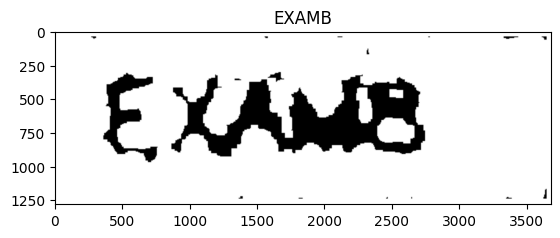
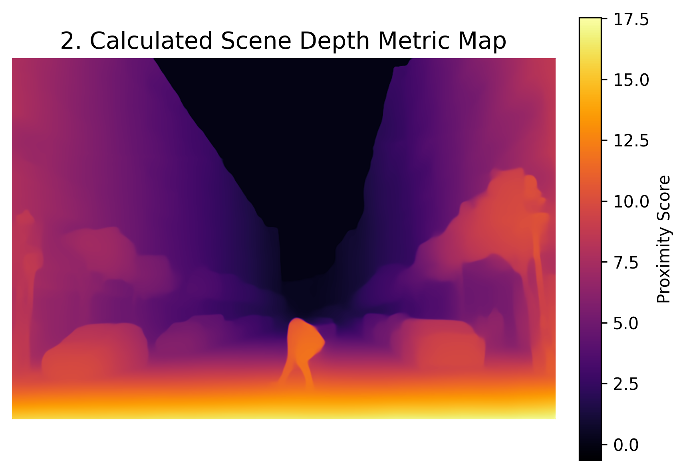
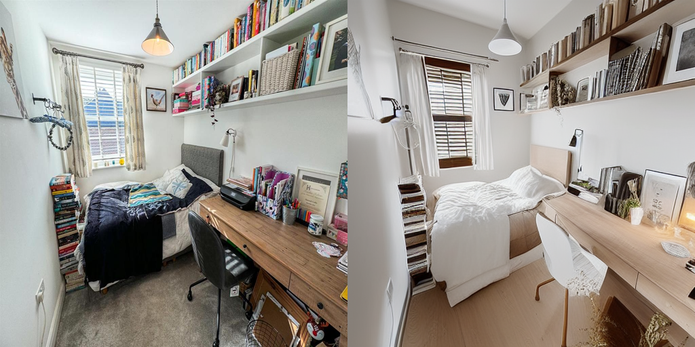
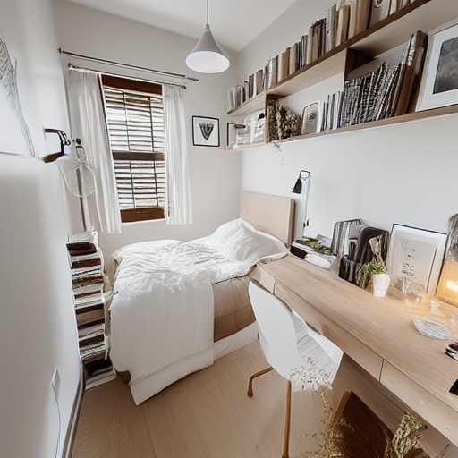
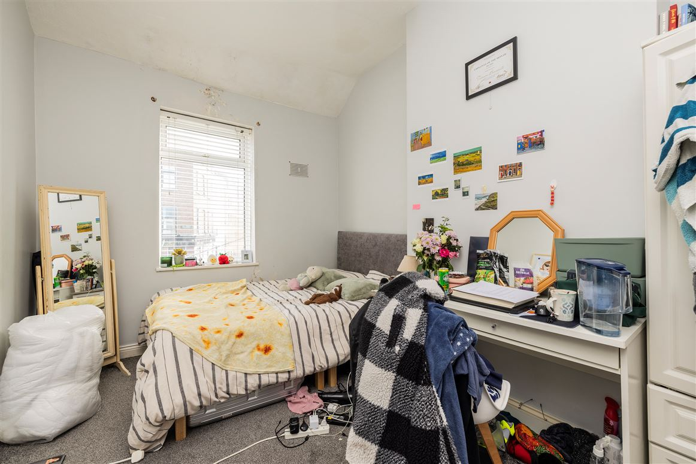

# Computer Vision and Generative AI Labs


A collection of three academic laboratories exploring **Computer Vision and Generative AI**, ranging from classical image preprocessing and optical character recognition to modern foundation models (Grounding DINO, Segment Anything, Depth Anything) and diffusion-based image generation (Stable Diffusion with ControlNet).

## 1. Project Overview

This repository brings together three independent yet complementary experiments, each implemented in a dedicated Jupyter notebook and documented with its inputs, outputs, and visual results.

| Lab | Focus | Key Technologies |
|---|---|---|
| **1 — OCR and Image Preprocessing** | Text extraction from a degraded, noisy image | OpenCV, Tesseract OCR |
| **2 — Detection, Segmentation and Depth** | Full scene understanding from a single image | Grounding DINO, SAM, Depth Anything |
| **3 — Generative Interior Redesign** | Image-to-image generation with structural guidance | Stable Diffusion, ControlNet |

The progression follows a pedagogical path: from **pixel-level processing** (Lab 1), through **semantic scene analysis** (Lab 2), to **creative image synthesis** (Lab 3).

## 2. Objectives

The main objectives of the project are as follows:

- Improve OCR accuracy on a difficult image through a rigorous preprocessing pipeline.
- Combine text-prompted detection, mask generation, and monocular depth estimation in a single analysis pipeline.
- Explore diffusion-based image-to-image generation while preserving structural layout via ControlNet.
- Document each experiment reproducibly, with inputs, outputs, and visual comparisons versioned in the repository.

## 3. Laboratories

### 3.1. Lab 1 — OCR and Image Preprocessing

**Technologies:** Python · OpenCV · Tesseract OCR

This lab explores image preprocessing techniques designed to improve optical character recognition on a noisy, difficult-to-read image.

**What it covers**

- Grayscale conversion and noise reduction.
- Otsu thresholding and morphological operations.
- Image resizing and border padding.
- Text extraction using an OCR engine.

**Before / After**

| Original image | Processed image |
|:---:|:---:|
|  |  |

**Notebook:** [ocr_preprocessing.ipynb](ex1-ocr/ocr_preprocessing.ipynb)

### 3.2. Lab 2 — Object Detection, Segmentation and Depth Estimation

**Technologies:** Python · Grounding DINO · Segment Anything (SAM) · Depth Anything

A computer vision pipeline combining three model capabilities to analyze a real-world scene.

**What it covers**

- Detecting objects from a text prompt using Grounding DINO.
- Generating object segmentation masks with SAM.
- Estimating relative scene depth with Depth Anything.
- Visualizing and combining model outputs.

**Input scene**


**Detection and segmentation**


**Depth estimation**



**Notebook:** [detection_segmentation_depth.ipynb](ex3-detection-segmentation-depth/detection_segmentation_depth.ipynb)

*Note: The depth map represents model-estimated depth. It should not be interpreted as calibrated physical distances without additional validation.*

### 3.3. Lab 3 — Generative AI for Interior Redesign

**Technologies:** Python · Hugging Face Diffusers · Stable Diffusion · ControlNet

An image-to-image generation workflow that explores how diffusion models can redesign an existing bedroom while using structural guidance to help preserve the room's layout.

**What it covers**

- Preparing an input image and extracting structural edges.
- Conditioning image generation with ControlNet.
- Designing positive and negative prompts.
- Generating and comparing the redesigned image with the original.

**Before / After comparison**



**Generated result**



**Original image**



**Notebook:** [interior_redesign.ipynb](ex4-interior-redesign/interior_redesign.ipynb)

*Note: Generated images may change some original details. ControlNet provides structural guidance but does not guarantee exact preservation.*

## 4. Pipeline Summary

| Lab | Processing Pipeline |
|---|---|
| **1** | Load → grayscale → noise reduction → Otsu thresholding → morphology → resize + border → OCR |
| **2** | Text prompt → Grounding DINO detection → SAM segmentation masks → Depth Anything estimation → combined visualization |
| **3** | Input image → structural edge extraction → ControlNet conditioning → prompt design → diffusion image-to-image → comparison |

## 5. Technologies Used

| Technology | Usage |
|---|---|
| Python | Main project language |
| Jupyter Notebook | Interactive development and execution of each lab |
| OpenCV | Image preprocessing, morphology, resizing, and padding (Lab 1) |
| Tesseract OCR (PyTesseract) | Optical character recognition (Lab 1) |
| Grounding DINO | Open-vocabulary object detection from text prompts (Lab 2) |
| Segment Anything (SAM) | Generation of object segmentation masks (Lab 2) |
| Depth Anything | Monocular depth estimation (Lab 2) |
| Hugging Face Diffusers | Diffusion model orchestration (Lab 3) |
| Stable Diffusion + ControlNet | Image-to-image generation with structural guidance (Lab 3) |

## 6. Repository Structure

The current repository structure is as follows:

```text
computer-vision-labs/
├── README.md
├── requirements.txt
├── .gitignore
├── ex1-ocr/
│   ├── ocr_preprocessing.ipynb
│   ├── images/
│   │   └── original.png
│   └── results/
│       └── output.png
├── ex3-detection-segmentation-depth/
│   ├── detection_segmentation_depth.ipynb
│   ├── images/
│   │   └── input_image.jpg
│   └── results/
│       ├── detected_and_segmented.png
│       └── depth_map.png
└── ex4-interior-redesign/
    ├── interior_redesign.ipynb
    ├── images/
    │   └── input_image_ex4.jpg
    └── results/
        ├── ex4_output_after.png
        └── ex4_output_comparaison.png
```

## 7. Prerequisites

To run the laboratories, the following elements are required:

- Python 3.10 or a compatible version for the selected library versions.
- Jupyter Notebook.
- Dependencies listed in `requirements.txt`.
- Tesseract OCR installed separately at the system level (Lab 1).
- Additional model dependencies and checkpoints for Labs 2 and 3.

## 8. Installation and Execution

### 8.1. Project Retrieval

Clone the Git repository:

```bash
git clone <https://github.com/mohammed-boujaada/votre-nom-de-repo.git>
cd <computer-vision-and-generative-ai-labs>
```


### 8.2. Environment Setup

Create and activate a virtual environment:

```bash
python3 -m venv .venv
source .venv/bin/activate
```

On Windows, activate it using:

```powershell
.venv\Scripts\activate
```

Install the dependencies:

```bash
python -m pip install --upgrade pip
python -m pip install -r requirements.txt
python -m pip install notebook
```

### 8.3. Notebook Execution

Launch Jupyter Notebook:

```bash
jupyter notebook
```

Open the notebook corresponding to the lab you want to explore and execute the cells in order.

### 8.4. Additional Setup per Lab

- **Lab 1:** Install the Tesseract OCR executable for your operating system. The `pytesseract` Python package acts as an interface to it.
- **Lab 2:** Download the required model checkpoints and follow the setup instructions in the notebook. The SAM checkpoint is not included in this repository.
- **Lab 3:** The diffusion models and ControlNet weights may require substantial disk space, RAM, and GPU memory. Follow the notebook's model-loading instructions.

Exact compatibility and resource requirements depend on the Python environment, library versions, models, and available hardware.

## 9. Notes and Limitations

- These notebooks present selected academic implementations and experiments.
- Results may vary depending on library versions, model checkpoints, hardware, and input images.
- Model weights and large checkpoints are not included in the repository.
- Use images and model checkpoints according to their licenses and usage terms.

## 10. Image Credits

Some images used in these labs were sourced from Google Images for educational and demonstration purposes. All rights belong to their respective owners.

## 11. Author

<div align="center">

<table>
<tr>
<td align="center">
<a href="https://github.com/mohammed-boujaada">

<br/>
<sub><b>Mohammed Boujaada</b></sub>
</a>
<br/>
MIATE Master's — FSA Nador
<br/>
<a href="https://github.com/mohammed-boujaada">

</a>
<a href="https://www.linkedin.com/in/mohammed-boujaada-229a3333a/">

</a>
</td>
</tr>
</table>

</div>

**Institution**: FSA Nador — Master's in Artificial Intelligence & Emerging Technologies  
**Module**: Computer Vision & Generative AI  
**Academic Year**: 2025 - 2026

